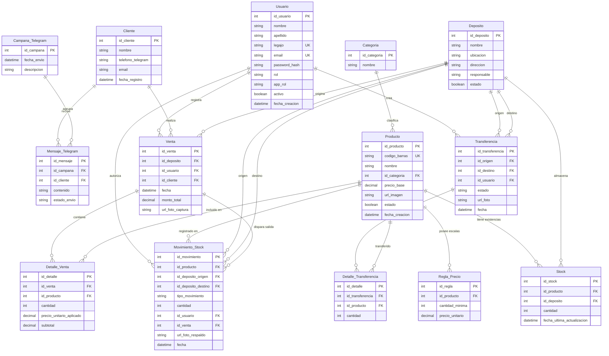

# Modelo de Datos — StockIA

El modelo de datos de **StockIA** fue diseñado bajo estrictos criterios de normalización en tercera forma normal (3FN) para soportar las operaciones transaccionales del sistema (catálogo de productos, control multi-sucursal de stock, ventas manuales con cálculo dinámico de precios y remitos de transferencia) y, al mismo tiempo, asentar la base arquitectónica para acoplar el reconocimiento por imágenes (Barcode + OCR) y el módulo de fidelización mediante Telegram.

Se encuentra implementado en el esquema de Prisma: [backend/prisma/schema.prisma](../backend/prisma/schema.prisma).

---

## 1. Decisiones Clave de Diseño

1. **Gestión de Inventario Multi-Sucursal:**  
   La relación de muchos a muchos entre `Producto` y `Depósito` se desacopla a través de la entidad intermedia `Stock`. El stock no es un atributo estático del producto, sino una propiedad de la combinación `(Producto, Depósito)`. Esto permite que una misma mercadería exista en múltiples sucursales con existencias independientes sin redundancia de datos.

2. **Reglas de Precios Dinámicos por Volumen:**  
   En lugar de ligar un único precio fijo a la entidad `Producto`, la lógica de precios se modeló en la entidad `Regla_Precio` (`PriceRule`). Esto da soporte nativo a precios diferenciales por escala o compra mayorista (por ejemplo, precio unitario estándar vs. precio especial a partir de 10 unidades).

3. **Trazabilidad y Auditoría para el Motor de IA:**  
   Las entidades de ventas y transferencias incorporan campos dedicados (`url_foto_captura` / `photoData` y `url_foto_respaldo`). Esto asegura la persistencia de la evidencia fotográfica procesada por el pipeline de visión computacional (`zxing-cpp` y `PaddleOCR`), garantizando la auditoría total de cada operación automatizada.

4. **Logística de Movimientos Unificada:**  
   La entidad `Movimiento_Stock` (`StockMovement` / `Transfer`) centraliza toda alteración de inventario. Al vincular depósitos de origen y destino junto con el usuario responsable y la referencia a la venta o remito, se garantiza trazabilidad inmutable de entradas, salidas y transferencias inter-sucursal.

5. **Preparación Temprana para Marketing (Telegram):**  
   Se proyectaron las entidades `Cliente`, `Campana_Telegram` y `Mensaje_Telegram` (`TelegramOffer`). Esto garantiza que la posterior incorporación de alertas y ofertas personalizadas según hábitos de compra no provoque cambios disruptivos en las tablas transaccionales ya existentes.

---

## 2. Diagrama Entidad-Relación (DER Completo)

---

## 3. Descripción de Entidades y Mapeo Prisma

### `User` (`users`)
Representa a los operadores del sistema (autenticación y trazabilidad de acciones).
- **Campos:** `id` (PK autoincremental), `name`, `email` (único), `password` (hash bcrypt), `role` (`ADMIN` \| `USER`), `appRole` (`administrador` \| `caja` \| `deposito`), `createdAt`.
- **Relaciones:** Ventas registradas, transferencias emitidas y ofertas creadas.

### `Product` (`products`)
Catálogo unificado de productos comercializados.
- **Campos:** `id` (PK), `name`, `code` (único — corresponde al código de barras EAN-13/UPC), `category`, `price` (Decimal 10,2 — precio base para 1 unidad), `lowStockThreshold`, `imageUrl`, `active` (borrado lógico), `createdAt`, `updatedAt`.
- **Integridad:** `code` es único a nivel de base de datos. Ningún producto con historial puede eliminarse físicamente (`onDelete: Restrict`).

### `PriceRule` (`price_rules`)
Escalas de precios por volumen para un mismo artículo.
- **Campos:** `id` (PK), `productId` (FK), `minQuantity` (Int), `price` (Decimal 10,2).
- **Restricción:** Índice único compuesto `(productId, minQuantity)`. Se elimina en cascada si se da de baja el producto.

### `Deposit` (`deposits`)
Puntos físicos de almacenamiento y venta (sucursales o almacenes).
- **Campos:** `id` (PK), `name` (único), `location`, `type` (Principal, Sucursal, etc.), `address`, `manager`, `createdAt`.
- **Relaciones:** Existencias de stock, movimientos de inventario, ventas locales y transferencias entrantes/salientes.

### `Stock` (`stock`)
Existencia física de un producto en un depósito específico.
- **Campos:** `id` (PK), `productId` (FK `Restrict`), `depositId` (FK `Restrict`), `quantity` (Int >= 0), `updatedAt`.
- **Restricción:** Índice único compuesto `(productId, depositId)`. Garantiza que solo exista un registro de balance por producto en cada sucursal.

### `StockMovement` (`stock_movements`)
Libro mayor de auditoría de inventario.
- **Campos:** `id` (PK), `productId` (FK), `depositId` (FK), `quantity` (Int positivo), `type` (`IN` \| `OUT` \| `ADJUST`), `reason`, `createdAt`.
- **Índice:** `(productId, depositId, createdAt)` para acelerar consultas de auditoría y trazabilidad histórica.

### `Sale` y `SaleItem` (`sales`, `sale_items`)
Comprobantes de venta y detalle de ítems facturados.
- **`Sale`:** `id` (PK), `depositId` (FK), `customerId` (FK nullable), `userId` (FK nullable), `total` (Decimal 10,2), `photoData` (base64 o URL de evidencia visual de IA), `photoMimeType`, `createdAt`.
- **`SaleItem`:** `id` (PK), `saleId` (FK `Cascade`), `productId` (FK `Restrict`), `quantity` (Int), `price` (Decimal — precio unitario histórico congelado al momento de la venta), `warehouseId` (FK nullable).

### `Transfer` y `TransferItem` (`transfers`, `transfer_items`)
Remitos y movimientos de mercadería entre sucursales.
- **`Transfer`:** `id` (PK), `originWarehouseId` (FK), `destinationWarehouseId` (FK), `status`, `userId` (FK), `photoData`, `photoMimeType`, `createdAt`.
- **`TransferItem`:** `id` (PK), `transferId` (FK `Cascade`), `productId` (FK `Restrict`), `quantity` (Int).

### `Customer` (`customers`) y `TelegramOffer` (`telegram_offers`)
Estructuras proyectadas para la fidelización de clientes y campañas automáticas por Telegram.
- **`Customer`:** `id` (PK), `name`, `contact`, `email`, `phone`, `createdAt`.
- **`TelegramOffer`:** `id` (PK), `message` (Text), `status`, `productIds` (JSON), `customerIds` (JSON), `userId` (FK), `createdAt`.
