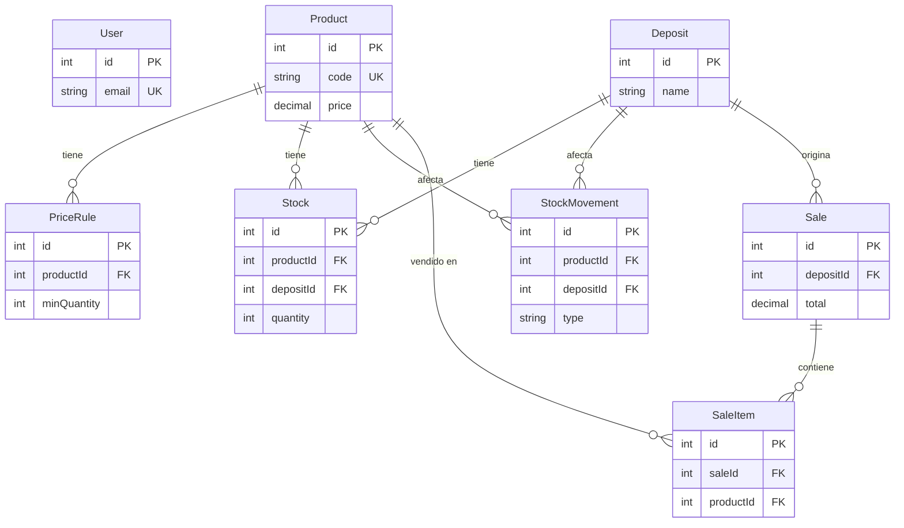

# Modelo de datos — StockIA (Sprint 1)

Implementado en [backend/prisma/schema.prisma](../backend/prisma/schema.prisma).

## Entidades

### User
Usuarios del sistema (autenticación, SB-016/018/019).
- `id`, `name`, `email` (único), `password` (hash bcrypt), `role` (`ADMIN`|`USER`), `createdAt`.

### Product
Catálogo de productos.
- `id`, `name`, `code` (**único** — es el SKU, la identidad real del producto; `name` puede repetirse), `category?`, `price` (Decimal 10,2 — precio base de 1 unidad), `imageUrl?` (referencia a almacenamiento externo, nunca un blob), `active` (default true), `createdAt`, `updatedAt`.
- Relaciones: `priceRules[]`, `stocks[]`, `stockMovements[]`, `saleItems[]`.

### PriceRule
Precio aplicable a partir de una cantidad mínima de unidades (ver [pricing.md](pricing.md)).
- `id`, `productId` FK → Product (`onDelete: Cascade`), `minQuantity` (Int), `price` (Decimal 10,2).
- Único compuesto `(productId, minQuantity)`.

### Deposit
Depósitos/sucursales físicas.
- `id`, `name`, `location?`, `createdAt`.
- Relaciones: `stocks[]`, `stockMovements[]`, `sales[]`.

### Stock
El stock es propiedad de la **relación** Producto+Depósito, nunca un atributo de Producto. Así el mismo producto puede tener cantidades distintas en cada depósito sin duplicar el producto.
- `id`, `productId` FK → Product (`onDelete: Restrict`), `depositId` FK → Deposit (`onDelete: Restrict`), `quantity` (Int, default 0), `updatedAt`.
- Único compuesto `(productId, depositId)` — no puede existir más de una fila de stock para el mismo par producto/depósito.
- `onDelete: Restrict` en ambas FKs: no se puede borrar un producto o depósito que tenga stock registrado, para evitar perder trazabilidad silenciosamente.
- CHECK a nivel de base `quantity >= 0` (ver [stock-rules.md](stock-rules.md)).

### StockMovement
Registro de trazabilidad de toda modificación de stock (ver [stock-rules.md](stock-rules.md)).
- `id`, `productId` FK → Product (`Restrict`), `depositId` FK → Deposit (`Restrict`), `quantity` (Int, siempre positivo — el signo lo da `type`), `type` (`IN`|`OUT`|`ADJUST`), `reason?`, `createdAt`.
- Índice `(productId, depositId, createdAt)` para consultas de historial.
- Extensible a futuro: `TRANSFER_IN`, `TRANSFER_OUT`, `RETURN` sin cambios estructurales, solo agregando valores al enum `MovementType`.

### Sale / SaleItem
Ventas confirmadas.
- `Sale`: `id`, `depositId` FK → Deposit (`Restrict`), `total` (Decimal 10,2), `createdAt`.
- `SaleItem`: `id`, `saleId` FK → Sale (`onDelete: Cascade` — el detalle no tiene sentido sin la venta), `productId` FK → Product (`Restrict`), `quantity`, `price` (precio aplicado en el momento de la venta, no el precio actual del producto).

## Por qué no hay más entidades todavía

`Cliente`, `Transferencia` y `Reconocimiento` no se implementan en este Sprint (fuera de alcance explícito). El modelo actual no las bloquea:
- `Sale` puede ganar `customerId?` sin romper nada existente.
- Los tipos `TRANSFER_IN`/`TRANSFER_OUT` en `MovementType` cubren la trazabilidad de una futura transferencia entre depósitos sin cambiar `Stock` ni `StockMovement`.
- El reconocimiento de imágenes es un flujo previo a la creación/actualización de `Product`/`Stock`, no requiere cambios en estas entidades.

## Diagrama de relaciones

