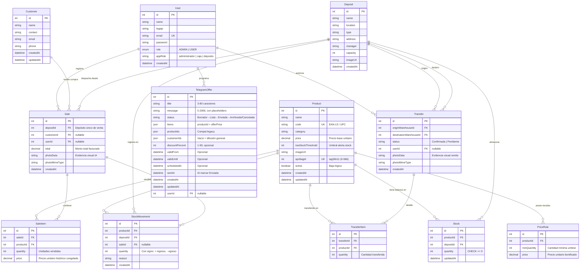

# Modelo de Datos — StockIA

El modelo de datos de **StockIA** fue diseñado bajo criterios de normalización en tercera forma normal (3FN) para soportar las operaciones transaccionales del sistema (catálogo unificado de productos, control multi-sucursal de stock, ventas asistidas por visión computacional con cálculo dinámico de precios y remitos de transferencia interdepósito) y, al mismo tiempo, asentar la base para el módulo de fidelización mediante Telegram.

Se encuentra implementado de forma canónica en el esquema de Prisma: [backend/prisma/schema.prisma](../backend/prisma/schema.prisma) y administrado mediante migraciones sobre PostgreSQL.

---

## 1. Decisiones Clave de Diseño y Evolución de Arquitectura

1. **Gestión de Inventario Multi-Sucursal Desacoplada:**  
   La relación de muchos a muchos entre `Product` y `Deposit` se resuelve mediante la entidad intermedia `Stock`. El saldo de inventario es una propiedad de la tupla `(productId, depositId)`. Esto garantiza que una misma mercadería exista en múltiples sucursales con existencias independientes sin redundancia de datos.
   
2. **Restricción a Nivel de Motor contra Sobregiros:**  
   La tabla `stock` cuenta con un constraint de base de datos relacional `CHECK (quantity >= 0)`. Toda reducción de stock se ejecuta mediante transacciones atómicas con descuento condicional (`quantity: { gte: qty }`), garantizando que jamás se produzca un inventario negativo aun bajo condiciones de alta concurrencia.

3. **Reglas de Precios Dinámicos por Volumen (`PriceRule`):**  
   En lugar de ligar un único precio estático a la entidad `Product`, la lógica de precios mayoristas se desacopla en `PriceRule`. Esto provee soporte para escalas de bonificación por volumen (por ejemplo, precio minorista base vs. precio especial a partir de 6 o 12 unidades).

4. **Movimientos Contables con Signo (+/-) y un Único Depósito:**  
   En el Sprint 2 se refactorizó `StockMovement` para adoptar un modelo contable de partida doble simplificada:
   - Se eliminó el enumerador `type` (`IN`/`OUT`/`ADJUST`).
   - La dirección del movimiento se determina directamente por el **signo** de `quantity` (positivo para altas o ingresos, negativo para bajas o ventas).
   - Cada movimiento referencia a un **único `depositId`**.
   - Una transferencia entre dos depósitos genera exactamente dos movimientos atómicos correlacionados: uno negativo en el origen y otro positivo en el destino, conservando la masa total.

5. **Venta Centralizada en un Solo Depósito:**  
   Se eliminó la columna `warehouseId` de `SaleItem`. La cabecera `Sale` define un único `depositId` de despacho. Si un cliente solicita productos de múltiples depósitos, la operación debe resolverse mediante transferencias previas de mercadería o mediante ventas independientes.

6. **Trazabilidad y Auditoría de Visión Computacional:**  
   Las entidades `Sale` y `Transfer` incorporan los campos `photoData` (base64 de la imagen procesada) y `photoMimeType`. Esto asegura la persistencia de la evidencia fotográfica procesada por el pipeline de IA (`zxing-cpp` y `PaddleOCR`), auditando el origen de las lecturas.

7. **Proyección para Fidelización y Marketing (`Customer` y `TelegramOffer`):**  
   Se incluyen las entidades de clientes y ofertas programadas de Telegram para permitir campañas automáticas sin requerir cambios estructurales posteriores en las tablas transaccionales.

8. **Identificadores Fiduciales AprilTags (`apriltag_id`):**  
   Para la trazabilidad física y reconocimiento visual instantáneo, la tabla `products` incorpora la columna `apriltag_id` (`UNIQUE`, rango 0 a 586 de la familia `tag36h11`). La asignación es secuencial y automática al registrar productos. Cuando un producto se desactiva mediante baja lógica (`active = false`), su `apriltag_id` permanece reservado para evitar colisiones con etiquetas físicas ya adheridas a mercadería existente.

9. **Personalización Visual de Depósitos (`imageUrl`):**  
   La entidad `deposits` soporta una URL de imagen de portada para identificación visual inmediata en el panel de control, con tratamiento de contraste y sombreado adaptativo en la interfaz.

---

## 2. Diagrama Entidad-Relación (DER Actualizado)

---

## 3. Especificación Detallada de Entidades (Prisma ORM)

### `User` (Tabla `users`)
Operadores con credenciales del sistema, perfiles de acceso y trazabilidad de acciones operativas.
- **`id`** (`Int`, PK autoincremental).
- **`name`** (`String`): Nombre completo del colaborador.
- **`legajo`** (`String`, default `""`): Identificador interno administrativo.
- **`email`** (`String`, Unique): Correo electrónico corporativo utilizado para autenticación.
- **`password`** (`String`): Contraseña hasheada mediante algoritmo seguro `bcrypt` (10 rounds).
- **`role`** (`Role`, enum `ADMIN` \| `USER`): Nivel de privilegios de infraestructura.
- **`appRole`** (`String`, default `"caja"`): Rol funcional de aplicación (`"administrador"`, `"caja"`, `"deposito"`).
- **`createdAt`** (`DateTime`, default `now()`).
- **Relaciones:** `sales` (`Sale[]`), `transfersCreated` (`Transfer[]`), `telegramOffers` (`TelegramOffer[]`).

### `Product` (Tabla `products`)
Catálogo maestro de mercaderías gestionadas por la empresa.
- **`id`** (`Int`, PK autoincremental).
- **`name`** (`String`): Descripción comercial del producto.
- **`code`** (`String`, Unique): Código universal de identificación comercial (EAN-13, EAN-8 o UPC). Punto de enlace con el pipeline de visión de IA.
- **`category`** (`String?`): Rubro o categoría del artículo.
- **`price`** (`Decimal(10,2)`): Precio base minorista para venta por unidad individual.
- **`lowStockThreshold`** (`Int`, default `5`): Cantidad de existencias mínimas para disparar alertas operativas de reposición.
- **`imageUrl`** (`String?`): Fotografía de referencia del envase o packaging.
- **`apriltagId`** (`Int?`, Unique, `@map("apriltag_id")`): Identificador único AprilTag (0-586 de la familia robótica `tag36h11`) vinculado para lectura por cámara y generación de etiquetas imprimibles A4.
- **`active`** (`Boolean`, default `true`): Flag de baja lógica.
- **`createdAt`**, **`updatedAt`** (`DateTime`).
- **Integridad:** `onDelete: Restrict` en todas sus referencias para proteger la integridad histórica de ventas y movimientos.

### `PriceRule` (Tabla `price_rules`)
Tramos de precios especiales por compra por volumen o escala mayorista.
- **`id`** (`Int`, PK autoincremental).
- **`productId`** (`Int`, FK hacia `Product.id` con `onDelete: Cascade`).
- **`minQuantity`** (`Int`): Umbral de unidades a partir del cual rige la bonificación.
- **`price`** (`Decimal(10,2)`): Precio unitario bonificado aplicable a cada unidad en ese tramo.
- **Restricción:** Índice único compuesto `@@unique([productId, minQuantity])`.

### `Deposit` (Tabla `deposits`)
Sucursales, almacenes físicos o centros de distribución logística.
- **`id`** (`Int`, PK autoincremental).
- **`name`** (`String`): Denominación de la sucursal (ej. "Almacén Central", "Sucursal Norte").
- **`location`** (`String?`), **`address`** (`String`), **`manager`** (`String`): Datos de radicación y responsable a cargo.
- **`type`** (`String`, default `"Principal"`): Tipo de dependencia física.
- **`capacity`** (`Int`, default `0`): Capacidad estimada en unidades físicas.
- **`imageUrl`** (`String?`), **`createdAt`** (`DateTime`).

### `Stock` (Tabla `stock`)
Balance actual de existencias de un producto en un depósito determinado.
- **`id`** (`Int`, PK autoincremental).
- **`productId`** (`Int`, FK hacia `Product.id` con `onDelete: Restrict`).
- **`depositId`** (`Int`, FK hacia `Deposit.id` con `onDelete: Restrict`).
- **`quantity`** (`Int`, default `0`): Cantidad física disponible.
- **`updatedAt`** (`DateTime`).
- **Restricciones:** 
  - `@@unique([productId, depositId])`: Solo puede existir un balance por producto en cada depósito.
  - Constraint PostgreSQL: `CHECK (quantity >= 0)`.

### `StockMovement` (Tabla `stock_movements`)
Libro mayor contable inmutable para auditoría de inventario.
- **`id`** (`Int`, PK autoincremental).
- **`productId`** (`Int`, FK hacia `Product.id` con `onDelete: Restrict`).
- **`depositId`** (`Int`, FK hacia `Deposit.id` con `onDelete: Restrict`).
- **`saleId`** (`Int?`, FK opcional hacia `Sale.id` con `onDelete: SetNull`).
- **`quantity`** (`Int`): Cantidad con signo. Un valor positivo indica incremento de inventario (ingreso o destino de transferencia); un valor negativo indica decremento (venta, merma o salida por transferencia).
- **`reason`** (`String?`): Motivo explicativo de la operación (ej. `"Venta #12"`, `"Transferencia #4: Salida hacia Sucursal Norte"`).
- **`createdAt`** (`DateTime`, default `now()`).
- **Índice:** `@@index([productId, depositId, createdAt])` para acelerar reportes de movimientos y auditorías de inventario.

### `Sale` y `SaleItem` (Tablas `sales` y `sale_items`)
Comprobantes comerciales y detalle de facturación de productos.
- **`Sale`**:
  - **`id`** (`Int`, PK autoincremental).
  - **`depositId`** (`Int`, FK hacia `Deposit.id` con `onDelete: Restrict`): Sucursal despachante obligatoria.
  - **`customerId`** (`Int?`, FK hacia `Customer.id` con `onDelete: SetNull`).
  - **`userId`** (`Int?`, FK hacia `User.id` con `onDelete: SetNull`): Cajero u operador emisor.
  - **`total`** (`Decimal(10,2)`): Importe total final de la venta calculado por el servidor aplicando escalas de precios.
  - **`photoData`** (`String?`, `@db.Text`), **`photoMimeType`** (`String?`): Captura visual enviada al terminal de ventas.
  - **`createdAt`** (`DateTime`, default `now()`).
- **`SaleItem`**:
  - **`id`** (`Int`, PK autoincremental).
  - **`saleId`** (`Int`, FK hacia `Sale.id` con `onDelete: Cascade`).
  - **`productId`** (`Int`, FK hacia `Product.id` con `onDelete: Restrict`).
  - **`quantity`** (`Int`): Unidades facturadas.
  - **`price`** (`Decimal(10,2)`): Precio unitario histórico efectivamente liquidado (congelado).

### `Transfer` y `TransferItem` (Tablas `transfers` y `transfer_items`)
Remitos y documentación de traslado de mercadería intersucursal.
- **`Transfer`**:
  - **`id`** (`Int`, PK autoincremental).
  - **`originWarehouseId`** (`Int`, FK hacia `Deposit.id`).
  - **`destinationWarehouseId`** (`Int`, FK hacia `Deposit.id`).
  - **`status`** (`String`, default `"Confirmada"`).
  - **`userId`** (`Int?`, FK hacia `User.id`): Operador que autoriza el traslado.
  - **`photoData`** (`String?`, `@db.Text`), **`photoMimeType`** (`String?`): Evidencia visual adjunta al remito.
  - **`createdAt`** (`DateTime`, default `now()`).
- **`TransferItem`**:
  - **`id`** (`Int`, PK autoincremental).
  - **`transferId`** (`Int`, FK hacia `Transfer.id` con `onDelete: Cascade`).
  - **`productId`** (`Int`, FK hacia `Product.id` con `onDelete: Restrict`).
  - **`quantity`** (`Int`): Unidades transferidas.

### `Customer` y `TelegramOffer` (Tablas `customers` y `telegram_offers`)
Entidades complementarias para fidelización y difusión omnicanal.
- **`Customer`**: `id`, `name`, `contact`, `email`, `phone`, `createdAt`, `updatedAt`.
- **`TelegramOffer`**: campaña con ciclo de vida propio.
  - `id`, `title` (3-80), `message` (5-2000, admite `{{nombre}}`, `{{productos}}`, `{{descuento}}`, `{{vigencia}}`).
  - `status`: `Borrador` → `Lista para enviar` → `Enviada` → `Archivada`, con `Cancelada` como vía de escape.
    Transiciones válidas: Borrador→{Lista para enviar, Cancelada}; Lista→{Enviada, Borrador, Cancelada};
    Enviada→{Archivada}; Archivada→{Borrador}; Cancelada→{Borrador}.
  - `items` (`Json`): `[{productId, offerPrice|null}]` (1-20 productos, todos activos; `offerPrice` < precio base).
    `productIds`/`customerIds` (`Json`) se conservan por compatibilidad (`customerIds` vacío = difusión general, máx. 200).
  - `discountPercent` (1-90, opcional), `validFrom`/`validUntil` (opcionales, `hasta >= desde`),
    `scheduledAt`, `sentAt`, `createdAt`, `updatedAt`, `userId`.
  - Reglas: no se lista ni se envía vencida ni sin stock en todos los productos;
    Enviada/Archivada son histórico (no se editan ni eliminan, solo se archivan o duplican).
  - Endpoints: `GET /telegram` (filtros `status`, `search`), `GET /telegram/suggest`,
    `GET /telegram/:id`, `GET /telegram/:id/preview`, `POST /telegram`, `PUT /telegram/:id`,
    `PATCH /telegram/:id` (solo estado), `POST /telegram/:id/duplicate`,
    `POST /telegram/:id/broadcast` (difusión a todos: limpia destinatarios y marca Enviada
    desde Borrador o Lista para enviar), `DELETE /telegram/:id`.
  - UX: Enviar respeta los destinatarios elegidos (exige Lista para enviar);
    Difundir es el botón aparte que manda a todos con confirmación previa.
