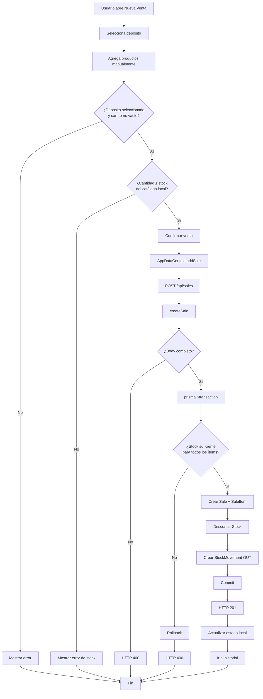

# Flujo de una venta manual — StockIA (SB-003)

> Este documento describe el comportamiento **real** implementado en el código a la fecha de este análisis. No describe cómo debería funcionar una venta, sino cómo funciona hoy, incluyendo lo que todavía es mock, lo que no está conectado y las inconsistencias detectadas entre frontend, backend y otra documentación.

## 1. Dónde se inicia una venta manual

La pantalla es [NewSale.jsx](../frontend/src/pages/sales/NewSale.jsx) (`/panel/nueva-venta`). El formulario tiene dos formas de cargar productos:

- **Detección por IA** (panel "DETECCIÓN DE PRODUCTOS (IA)"): permite adjuntar una foto, pero solo simula una detección — `onFile` guarda la imagen como preview local y, 600ms después, marca `detected = true` mostrando un mensaje de "Detección simulada lista". **No hay llamada a ningún servicio de reconocimiento de imágenes ni carga real de ítems a partir de la foto.**
- **Selección manual** (panel "SELECCIÓN MANUAL DE PRODUCTOS"): un buscador filtra `products` (del contexto) por nombre o SKU y agrega el producto elegido al carrito (`cart`) vía `addToCart`. Esta es la única vía que efectivamente carga ítems a la venta — SB-003 es justamente el análisis de este camino.

## 2. Qué datos pide el formulario

Estado local de `NewSale.jsx`:

| Campo UI | Variable | ¿Llega al backend? |
|---|---|---|
| Cliente | `clienteId` | **No.** `Sale` no tiene columna de cliente en el schema (ver §4). Solo se usa para mostrar `cliente` en el historial local. |
| Depósito de origen | `depositoId` | Sí, como `depositId`. |
| Método de pago | `metodoPago` | **No.** No existe en el modelo `Sale`. |
| Notas | `notas` | **No.** No existe en el modelo `Sale`. |
| Carrito (`cart`) | `productId`, `cantidad`, `precio` por ítem | Sí, mapeado a `items: [{ productId, quantity, price }]`. |

Es decir: de todo lo que el formulario permite cargar, **solo el depósito y los ítems (producto/cantidad/precio) se persisten realmente**. Cliente, método de pago y notas quedan únicamente en el estado en memoria del frontend.

## 3. Productos y cantidades

Cada fila del carrito guarda `productId`, `precio` (tomado tal cual del catálogo mock en el momento de agregarlo) y `cantidad` (editable con +/-/input numérico, mínimo 1 — `Math.max(1, next)` en `changeQty`, y `isNaN(n) || n < 1 ? 1 : n` en `setQty`). No hay tope superior en el frontend más allá de la validación de stock disponible antes de enviar.

Según [pricing.md](pricing.md), `sale.controller.js` **no resuelve `PriceRule`**: recibe el `price` que ya viene decidido por el cliente de la API (en este caso, el precio base cacheado en el carrito). No hay precio por cantidad en este flujo todavía.

## 4. Qué depósito interviene

Un único depósito por venta: `depositoId`, seleccionado de un `<select>` con las opciones de `deposits` (contexto). Todos los ítems de una misma venta descuentan stock de ese mismo depósito — no hay soporte para vender ítems de distintos depósitos en una sola operación.

## 5. Cómo se calcula el total

- **Frontend (`NewSale.jsx`)**: `subtotal` = suma de `precio * cantidad` del carrito; `iva = subtotal * 0.21` (constante `IVA_RATE`, hardcodeada); `total = subtotal + iva`. Este total solo se usa para mostrarlo en pantalla y en el mensaje de éxito al navegar al historial.
- **Frontend (`AppDataContext.addSale`)**: **recalcula el total de forma independiente** — `data.items.reduce((a, it) => a + it.precio * it.cantidad, 0) * 1.21` — y es este valor el que efectivamente se envía como `total` en el body de `POST /api/sales`. En la práctica da el mismo resultado que el de `NewSale.jsx` porque ambos aplican el mismo 21%, pero son dos cálculos duplicados e independientes, no un valor que se pasa de un lugar a otro.
- **Backend (`sale.controller.js`)**: `total` **no se recalcula ni se valida contra `items`**. Se recibe del body y se persiste tal cual: `total: parseFloat(total)`. El backend confía ciegamente en el total que le manda el cliente; no hay ninguna verificación de que `total === Σ(price * quantity)` (con o sin IVA).

## 6. Endpoint/backend que participa

- Ruta: `POST /api/sales`, definida en [sale.routes.js](../backend/routes/sale.routes.js), montada en `/api/sales` desde [server.js](../backend/server.js).
- Handler: [`createSale`](../backend/controllers/sale.controller.js).
- Historial: `GET /api/sales` → [`getSales`](../backend/controllers/sale.controller.js), usado por [SalesHistory.jsx](../frontend/src/pages/sales/SalesHistory.jsx) — aunque, como se detalla en §17, `SalesHistory.jsx` en realidad **no llama a esta API**, lee `sales` del contexto local.

## 7. Validaciones realizadas

**Frontend (`NewSale.jsx`, antes de enviar):**
1. `depositoId` no vacío.
2. `cart.length > 0`.
3. Para cada ítem del carrito, `cantidad <= disponiblePorProducto(productId)` — comparado contra `products[].stock[depositoId]` del catálogo **mock** cacheado en el contexto, no contra el stock real del servidor en el instante del submit. Si falla, se corta el envío y se muestra `cartError` (no llega a llamar a la API).

**Backend (`createSale`):**
1. Body completo: `depositId`, `items` (array no vacío) y `total` deben estar presentes; si no, `400`.
2. **No valida** que `depositId` o cada `productId` correspondan a registros existentes de forma explícita (no hay `findUnique` de `Product`/`Deposit` como sí ocurre en `adjustStock`). Si `depositId` no existe, la creación de `Sale` falla por la FK (`onDelete: Restrict` desde `sales.depositId`) y cae en el `catch` genérico como `400`. Si `productId` no existe, ocurre lo mismo al crear `SaleItem`.
3. **No valida tipos/formatos** de `productId`, `quantity`, `price` más allá de convertirlos con `Number(...)`/`parseFloat(...)` — un valor no numérico produce `NaN`, que Prisma rechazará al escribir, y el error también termina como `400` genérico.
4. Valida stock suficiente por cada ítem (ver §8).

## 8. Cómo se verifica el stock

Dentro de `prisma.$transaction`, **antes de crear nada**, `createSale` recorre `items` y busca la fila `Stock` para `(productId, depositId)` vía la clave única compuesta `productId_depositId`. Si no existe la fila de stock para ese par, o `stockRecord.quantity < item.quantity`, lanza un `Error` que aborta toda la transacción.

Este patrón (validar-todo-antes-de-escribir) es el documentado como contrato obligatorio en [backend-integration.md](backend-integration.md) y en [stock-rules.md](stock-rules.md) para cualquier flujo que descuente stock.

## 9. Qué ocurre si no hay stock suficiente

- El `throw` dentro del callback de `$transaction` hace que Prisma revierta toda la transacción: no queda `Sale`, ni `SaleItem`, ni cambios en `Stock`, ni `StockMovement` huérfano.
- El `catch` externo de `createSale` responde `400` con `{ error: 'Error al procesar la venta', details: error.message }`, donde `details` es literalmente `Stock insuficiente para el producto ID <id>`.
- Es **todo o nada**: si un ítem de varios no tiene stock suficiente, ningún ítem de esa venta se procesa (verificado en el test "todo o nada", ver §17).
- El frontend recibe esto como `ApiError` (vía [api.js](../frontend/src/services/api.js)) y `AppDataContext.addSale` lo relanza sin tocar el estado local: no se agrega la venta al historial mock ni se descuenta stock local (comentario explícito en el código: *"El servidor rechazó la venta (p.ej. stock insuficiente): no la registramos como completada ni descontamos stock local"*). `NewSale.jsx` muestra el mensaje de error en `formError`.

## 10. Cómo se registra `Sale`

Dentro de la misma transacción, después de validar stock: `tx.sale.create({ data: { depositId, total: parseFloat(total), items: { create: [...] } } })`. `total` se persiste como llegó del body (ver §5, sin recomputar). No se persisten cliente, método de pago ni notas porque el modelo `Sale` (schema.prisma) no tiene esas columnas.

## 11. Cómo se registran los `SaleItem`

Se crean en la misma llamada anidada (`items: { create: items.map(...) }`), como parte de la creación de `Sale` — Prisma genera las filas `SaleItem` con `productId`, `quantity` y `price` tomados directamente del body (sin resolver `PriceRule`, ver §3/§5). `saleId` se asigna automáticamente por la relación.

## 12. Cómo se descuenta el stock

Después de crear `Sale`+`SaleItem`, y todavía dentro de la misma transacción, por cada ítem: `tx.stock.update({ where: { productId_depositId }, data: { quantity: { decrement: quantity } } })`. Esto es un `update` directo, no un `upsert` — si la fila de `Stock` desapareciera entre la validación (§8) y este paso, fallaría (pero al estar todo en una única transacción con aislamiento de Prisma/Postgres, no hay ventana real para una condición de carrera externa a esta operación).

## 13. Cómo se registra `StockMovement`

Inmediatamente después de cada decremento de stock, en el mismo loop: `tx.stockMovement.create({ data: { productId, depositId, quantity, type: 'OUT', reason: `Venta #${sale.id}` } })`. El `reason` referencia el `id` de la `Sale` recién creada (disponible porque `sale` ya fue resuelta en el paso 2 de la transacción). Esto es consistente con la regla general documentada en [stock-rules.md](stock-rules.md): toda modificación de `Stock.quantity` va acompañada de un `StockMovement` en la misma transacción.

## 14. Transacción y manejo de fallas

Todo el flujo (validar stock → crear `Sale`/`SaleItem` → decrementar `Stock` → crear `StockMovement` por ítem) ocurre dentro de un único `prisma.$transaction(async (tx) => {...})`. Si **cualquier** paso lanza (stock insuficiente, FK inexistente, tipo de dato inválido, violación de constraint `quantity >= 0`, etc.), Prisma revierte automáticamente todo lo escrito hasta ese punto dentro de la transacción — no puede quedar una `Sale` sin sus `StockMovement`, ni un `Stock` descontado sin su `Sale`. El `catch` de `createSale` solo se encarga de traducir cualquier excepción (de la transacción o de la validación inicial de body) a una respuesta `400` con `details: error.message`.

No hay manejo diferenciado por tipo de error dentro de este controller (a diferencia de `adjustStock`, que sí distingue `404` de `400` vía `error.status`): en `createSale` **todo error termina en `400`**, incluso uno que conceptualmente sería un `404` (depósito/producto inexistente) o un `500` (error de conexión a la base).

## 15. Respuesta cuando la operación es exitosa

`201`, body:
```json
{
  "message": "Venta confirmada con éxito",
  "sale": {
    "id": 1,
    "depositId": 1,
    "total": "200.00",
    "createdAt": "...",
    "items": [ { "id": 1, "saleId": 1, "productId": 1, "quantity": 2, "price": "100.00" } ]
  }
}
```
(`sale` incluye `items` porque el `create` inicial usa `include: { items: true }`; no incluye `product` anidado — eso solo ocurre en `getSales`.)

## 16. Errores que puede devolver

| Caso | Status | Body |
|---|---|---|
| Body incompleto (`depositId`, `items` o `total` faltante/vacío) | `400` | `{ error: 'Datos incompletos. Se requiere depositId, total y una lista de items.' }` |
| Stock insuficiente en al menos un ítem | `400` | `{ error: 'Error al procesar la venta', details: 'Stock insuficiente para el producto ID <id>' }` |
| `depositId`/`productId` inexistente (falla de FK), tipos inválidos, o cualquier otra excepción de Prisma dentro de la transacción | `400` | `{ error: 'Error al procesar la venta', details: <mensaje de Prisma> }` |
| Error inesperado fuera de los casos anteriores | `400` (no hay rama `500` en este controller) | igual que el anterior |

## 17. Pruebas existentes que respaldan este flujo

Todo en [sale.test.js](../backend/tests/sale.test.js), llamando directamente a `createSale`/`getSales` (sin levantar el servidor HTTP, con `mockRes()` simulando `res`):

1. **"confirma una venta válida: descuenta stock y registra movimiento OUT"** — cubre §8 (stock suficiente pasa), §10/§11 (se crea `Sale` con su `SaleItem`), §12 (stock pasa de 20 a 18 tras vender 2), §13 (se crea un `StockMovement` `OUT` con `reason` `Venta #<id>`) y §15 (status `201`).
2. **"rechaza venta con stock insuficiente y no modifica nada"** — cubre §9: status `400`, el stock no cambia, no queda `Sale` ni `StockMovement`.
3. **"rechaza venta con múltiples ítems si uno solo tiene stock insuficiente (todo o nada)"** — cubre §14 (atomicidad): con dos ítems, uno con stock suficiente y otro sin él, ninguno se descuenta.
4. **"rechaza venta con datos incompletos"** — cubre la validación de §7.1 (falta `items`/`total`).
5. **"lista el historial de ventas con sus ítems y producto"** — cubre `getSales`, incluyendo `items.product` (usado por el historial si el frontend llegara a consumir esta API — ver §18).

**No hay pruebas** (ni backend ni frontend) que cubran: el cálculo de `total` en el frontend, la interacción del carrito en `NewSale.jsx`, la detección "IA" simulada, ni el camino donde `AppDataContext.addSale` cae a modo demo por error de red.

## 18. Backend implementado vs. frontend mockeado/no conectado

**Implementado y probado en backend:**
- `POST /api/sales` con validación de stock todo-o-nada, transacción atómica, creación de `Sale`/`SaleItem`, descuento de `Stock` y registro de `StockMovement` `OUT` — todo según §6 a §14.
- `GET /api/sales` con `items.product` incluido.

**Conectado al backend real (contrario a lo que sugiere la sección de "Desalineación frontend/backend" de [backend-integration.md](backend-integration.md), que describe el frontend completo como mock sin llamadas a la API):**
- `AppDataContext.addSale` **sí llama a `api.sales.create` (`POST /api/sales`) primero**. Si el servidor responde rechazando la venta (`ApiError`, p. ej. stock insuficiente), el error se relanza y el estado local no se toca — la UI no simula una venta exitosa. Esto está implementado y funciona según el código actual.
- Solo si la llamada falla por un problema de **conexión** (el `fetch` nunca llega a obtener una respuesta HTTP, no una `ApiError`) el flujo cae a un modo demo: crea la venta y descuenta stock únicamente en el estado en memoria del frontend, con un número de venta local (`nextSaleNumber`) en vez del `id` real de la base.

**Mockeado / no conectado al backend:**
- El catálogo de productos, depósitos y clientes que alimenta `NewSale.jsx` (`products`, `deposits`, `clients` del contexto) parte de datos hardcodeados en memoria ([AppDataContext.jsx](../frontend/src/context/AppDataContext.jsx)) con esquema en español (`nombre`, `sku`, `precio`, `stock: {depositoId: cantidad}`). Aunque `api.products.list()` se llama al montar el provider, su resultado **solo se usa para decidir `apiStatus` ("online"/"demo")** — la respuesta no se usa para poblar `products`. Es decir: el catálogo que ve el usuario en "Nueva Venta" (y por lo tanto la validación de stock disponible del §7) es siempre el mock local, nunca el inventario real de la base, incluso cuando el backend está disponible.
- **`SalesHistory.jsx` no llama a `GET /api/sales` en ningún momento** — lee directamente `sales` del contexto (`useAppData()`), que es el arreglo en memoria poblado por `buildInitialSales` más lo que se agregue vía `addSale`. Por lo tanto, ventas creadas exitosamente en el backend por otro cliente/sesión, o antes de recargar la página, no aparecen en este historial: la fuente de verdad que muestra la UI no es la base de datos.
- **Cliente, método de pago y notas** se capturan en el formulario y se muestran en el historial local, pero nunca se envían al backend — no hay dónde persistirlos porque el modelo `Sale` (`schema.prisma`) no tiene esas columnas (ver §2, §10).
- **Cálculo de IVA (21%)**: existe solo en el frontend (`NewSale.jsx` y, de forma duplicada, en `AppDataContext.addSale`); el backend no aplica ni conoce ningún IVA — persiste el `total` que recibe tal cual (§5).
- **Detección de productos por IA**: es una simulación de UI (`setTimeout` + flag `detected`), no hay integración con ningún servicio de visión ni endpoint backend para esto.
- **`PriceRule`** (precio por cantidad, ver [pricing.md](pricing.md)) no se resuelve en ningún punto de este flujo — ni frontend ni backend.

## 19. Observaciones

- Situación actual y mejora propuesta	
Stock del frontend usa datos mock, consultar stock real
Cliente/método de pago/notas no se persisten,	incorporarlos al modelo si son requisitos
El backend confía en total recibido, recalcular/validar total en backend
Historial usa estado local, consumir GET /api/sales

## 20. Diagrama de flujo
