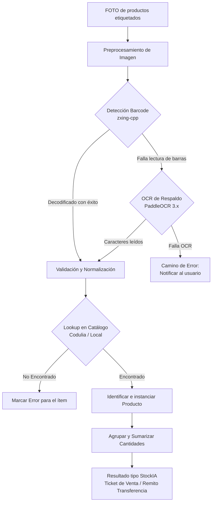
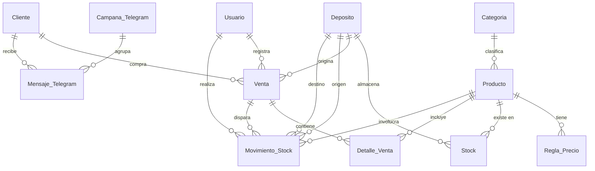

# Sprint 1 — Informe Académico de Entrega y Pivot Tecnológico

**Proyecto:** StockIA  
**Institución:** UTN – Facultad Regional San Francisco  
**Carrera:** Ingeniería en Sistemas de Información  
**Cátedra:** Ingeniería y Calidad de Software (Ciclo Lectivo 2026)  
**Fecha de entrega:** 02/09/2026  
**Integrantes:**
- Camino Matías
- Mecchia Valentín
- Perez Agustín
- Sereno Facundo José

**Profesores:**
- Gandino Diego
- Saldarini Javier Daniel

**Repositorio oficial:** [https://github.com/aguuperez5/StockIA](https://github.com/aguuperez5/StockIA)

---

## 1. Modificaciones del Product Backlog (Pivot Tecnológico)

Durante el inicio de este sprint se llevó a cabo una modificación crítica en el Product Backlog respecto al enfoque de inteligencia artificial y visión computacional.

### El problema con el enfoque original (YOLO)
Originalmente se proyectó utilizar un modelo de Machine Learning avanzado basado en detección de objetos y segmentación visual del packaging (tipo YOLO). Sin embargo, tras el análisis de viabilidad técnica y operativa, se determinó que este enfoque presentaba barreras insalvables para el ciclo del proyecto:
1. **Volumen desmedido de datos:** Se requieren cientos de fotografías por cada SKU bajo diferentes ángulos, condiciones de iluminación ambiental, distancias y niveles de oclusión.
2. **Costo de mantenimiento inaceptable:** Cada vez que el comercio incorpora un nuevo producto o el fabricante cambia el diseño del empaque, se requeriría re-etiquetar un dataset y re-entrenar el modelo completo.
3. **Ambigüedad y ruido:** Productos en botellas transparentes, bolsas deformables o envases similares introducían falsos positivos.

### La solución: Barcode primario con OCR de respaldo (Fallback)
Se decidió pivotar hacia una arquitectura híbrida de alta fiabilidad: **lectura de código de barras como método primario** y **OCR (Optical Character Recognition) como respaldo**.



---

### 1.1. Nuevo requerimiento de negocio agregado al Backlog

A partir de este pivot, se estableció un **requisito operativo estricto**:
> Todo producto administrado por la empresa debe estar identificado con un sticker adhesivo visible sobre fondo blanco, que contenga el **código de barras** y su correspondiente **numeración legible** debajo.

```
       || | ||||| | |||| |||| ||| ||
              7791337603615
```

---

### 1.2. Prueba de Concepto (PoC) implementada para validar la hipótesis

Se implementó y validó con éxito un pipeline en Python capaz de transformar una fotografía de un conjunto de productos en una lista estructurada de artículos listos para facturación:

1. **Entrada de Imagen:** Recepción de la captura fotográfica del lote de productos.
2. **Preprocesamiento:** Ajuste de contraste, conversión a escala de grises y corrección de perspectiva/brillo para optimizar la legibilidad.
3. **Detección Principal (`zxing-cpp`):** Intento de decodificación ultrarrápida del patrón de barras.
   - *Camino Ideal:* El código es decodificado y continúa directo a normalización.
   - *Camino Fallback:* Si las barras presentan reflejos o deformaciones, se invoca a `PaddleOCR 3.x` enfocado en leer los números impresos en la base de la etiqueta.
   - *Camino de Error:* Si ambos métodos fallan, se devuelve feedback visual inmediato solicitando una nueva toma.
4. **Validación y Normalización:** Limpieza de caracteres espurios y comprobación de formato numérico estándar (EAN-13 / UPC).
5. **Lookup en Catálogo:** Búsqueda en la base de datos (con soporte para la API de Codulia para productos de consumo masivo en Argentina o catálogo local en PostgreSQL).
6. **Consolidación de Cantidades:** Detección de múltiples apariciones del mismo ítem y sumarización automática de cantidades.
7. **Salida Final Estructurada:** Payload JSON con formato unificado de StockIA para poblar automáticamente los tickets de venta o remitos de transferencia.

---

## 2. Historias de Usuario Implementadas en el Sprint 1

El objetivo central del Sprint 1 fue materializar el núcleo transaccional del sistema: administración de productos, depósitos físicos, stock y ventas manuales con cálculo de precios y descuento de existencias en base de datos.

- **HU-01:** Registro de usuario.
- **HU-02:** Registrar producto.
- **HU-03:** Editar producto.
- **HU-04:** Visualizar listado de productos.
- **HU-05:** Registrar depósito.
- **HU-06:** Visualizar stock por depósito.
- **HU-07:** Actualización manual de stock.
- **HU-08:** Creación de venta manual.
- **HU-09:** Confirmación de venta.
- **HU-10:** Descuento automático de stock por venta.
- **HU-11:** Visualización de historial de ventas.

---

## 3. Sprint Backlog Utilizado y Descomposición del Trabajo

El equipo descompuso las Historias de Usuario en tareas atómicas de ingeniería (SB-001 a SB-055), cubriendo análisis, diseño, DevOps, desarrollo de capas y QA. A modo de ejemplo representativo:

### Descomposición de HU-02 (Registrar producto)
*COMO administrador, DESEO registrar un producto nuevo PARA incorporarlo al catálogo y utilizarlo en ventas, stock y transferencias.*

| ID Tarea | Descripción de la Actividad |
| :--- | :--- |
| **SB-020** | Implementar la entidad Producto en la base de datos mediante Prisma ORM. |
| **SB-021** | Implementar el endpoint (API REST) en el backend para registrar productos. |
| **SB-022** | Desarrollar el formulario visual de alta de productos en React. |
| **SB-023** | Implementar validaciones del formulario (campos obligatorios, tipos y formatos). |

### Descomposición de HU-08 (Creación de venta manual)
*COMO usuario de caja, DESEO crear una venta cargando productos manualmente PARA registrar una operación comercial sin depender todavía del reconocimiento automático.*

| ID Tarea | Descripción de la Actividad |
| :--- | :--- |
| **SB-036** | Implementar la entidad Venta en la base de datos. |
| **SB-037** | Implementar la entidad Detalle Venta para normalizar la relación con los productos. |
| **SB-038** | Desarrollar la pantalla de nueva venta en el Frontend. |
| **SB-039** | Programar la lógica visual para permitir seleccionar productos manualmente desde el catálogo. |
| **SB-040** | Añadir funcionalidad para permitir indicar y modificar cantidades por ítem. |
| **SB-041** | Programar la lógica de negocio para calcular automáticamente el subtotal y el total de la operación. |

*(El desglose exhaustivo de las 55 tareas se encuentra documentado en [sprint-backlog.md](sprint-backlog.md)).*

---

## 4. Implementación en el Sistema

La arquitectura implementada divide responsabilidades limpiamente:

1. **Capa de Persistencia y Backend:**
   - Base de datos PostgreSQL gestionada a través de migraciones de Prisma ORM.
   - Modelado de tablas: `User`, `Product`, `Deposit`, `Stock`, `StockMovement`, `Sale`, `SaleItem`, `PriceRule`, `Customer`, `Transfer`, `TransferItem` y `TelegramOffer`.
   - API RESTful construida con Node.js y Express con rutas versionadas y controladores aislados.
2. **Capa de Interfaz de Usuario (Frontend):**
   - SPA desarrollada en React con Vite y TypeScript.
   - Componentes modulares con validación interactiva en tiempo real.
   - Módulos funcionales de: Catálogo de Productos, Gestión de Depósitos, Stock por Sucursal, Punto de Venta (Caja) e Historial de Ventas.
3. **Lógica Transaccional (HU-09 y HU-10):**
   - Al confirmar una venta en la caja (`HU-09`), el backend ejecuta una transacción atómica que:
     - Persiste la cabecera de la venta y sus ítems de detalle.
     - Valida disponibilidad de stock en el depósito asignado.
     - Descuenta automáticamente el stock (`HU-10`).
     - Registra un `StockMovement` de tipo `OUT` como registro de auditoría inmutable.
4. **Preparación para Integración de IA:**
   - El catálogo de productos (`HU-02`, `HU-03`, `HU-04`) expone identificadores universales (códigos de barras EAN) listos para interactuar con el módulo Python de visión computacional.

---

## 5. Estimación de Esfuerzo y Valor de Negocio

| ID | Historia de Usuario | Esfuerzo Estimado | Valor que agrega al producto (Business Value) |
| :--- | :--- | :--- | :--- |
| **HU-01** | Registro de usuario | 1 hora | **Crítico:** Base indispensable para la seguridad, auditoría y control de acceso. |
| **HU-02** | Registrar producto | 2 horas | **Crítico:** Core del sistema; sin catálogo no hay inventario, reconocimiento ni ventas. |
| **HU-03** | Editar producto | 2 horas | **Alto:** Permite mantener actualizado el catálogo ante variaciones de costos y errores. |
| **HU-04** | Visualizar listado | 2 horas | **Alto:** Facilita la consulta ágil de existencias y precios por parte de los operadores. |
| **HU-05** | Registrar depósito | 1 hora | **Alto:** Permite escalar la solución a múltiples sucursales y ubicaciones físicas. |
| **HU-06** | Visualizar stock | 2 horas | **Alto:** Fundamental para la toma de decisiones de reposición y logística interna. |
| **HU-07** | Actualización stock | 2 horas | **Crítico:** Necesario para asentar stock inicial y conciliar discrepancias físicas. |
| **HU-08** | Creación venta manual | 3 horas | **Crítico:** Habilita el flujo comercial primario de facturación antes del acople de IA. |
| **HU-09** | Confirmación de venta | 2 horas | **Crítico:** Cierra formalmente la operación y genera el comprobante al cliente. |
| **HU-10** | Descuento automático | 2 horas | **Crítico:** Automatiza el inventario en tiempo real impidiendo desfasajes de stock. |
| **HU-11** | Historial de ventas | 1 hora | **Media:** Otorga trazabilidad de auditoría histórica para la administración. |

---

## 6. Retrospectiva del Sprint: Tiempos Teóricos vs. Reales

Durante la ejecución se monitorearon los desvíos entre las horas estimadas y las horas reales insumidas por el equipo:

- **Tiempo total estimado (Teórico):** 20 horas.
- **Tiempo total invertido (Real):** 22 horas.

```
Horas Estimadas: [====================] 20h
Horas Reales:    [======================] 22h  (+10%)
```

### Desvíos identificados en la retrospectiva:

1. **Configuración del ambiente (`SB-013` / `SB-014`):**
   - *Estimado:* 2 horas | *Real:* 4 horas.
   - *Causa:* Conflictos de versiones en entornos locales (Node, Docker, PostgreSQL) entre los equipos de los integrantes.
   - *Acción correctiva:* Se redactó un instructivo estandarizado de instalación (`docs/installation.md`) y se unificó la configuración vía Docker Compose.
2. **Prueba de Concepto OCR (Pivot Tecnológico):**
   - *Consumo extra:* 3 horas adicionales de investigación y benchmarking entre OpenCV, Tesseract, zxing-cpp y PaddleOCR.
   - *Evaluación:* Desvío altamente justificado, ya que redujo drásticamente el riesgo de fracaso del módulo de visión computacional.
3. **Desarrollo Frontend en React:**
   - *Resultado:* Tomó ligeramente menos tiempo de lo presupuestado gracias al diseño previo de wireframes en Figma y a la construcción de componentes modulares reutilizables.

---

## 7. Modelo de Datos y Decisiones Clave de Diseño

El diseño de la base de datos se estructuró bajo estrictos criterios de normalización transaccional:



### Decisiones de Arquitectura de Datos:
- **Gestión Multi-Sucursal:** Relación muchos a muchos entre `Producto` y `Deposito` resuelta mediante la tabla intermedia `Stock`, con existencias independientes por ubicación.
- **Reglas de Precios Dinámicos (`Regla_Precio`):** Precios desacoplados de la entidad producto para admitir descuentos por escala (precio minorista vs. mayorista por volumen).
- **Trazabilidad del Motor de IA:** Campos `url_foto_captura` y `url_foto_respaldo` en `Venta` y `Movimiento_Stock` para auditar la evidencia visual procesada.
- **Transferencias Unificadas:** La tabla `Movimiento_Stock` consolida entradas, salidas por ventas y transferencias entre depósitos mediante llaves de origen y destino.
- **Proyección de Marketing (Telegram):** Inclusión temprana de entidades `Cliente`, `Campana_Telegram` y `Mensaje_Telegram` para evitar refactorizaciones traumáticas al incorporar las promociones automáticas.
