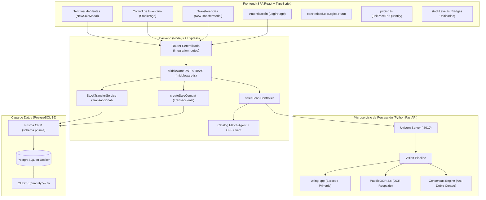

# Sprint 2 — Informe Académico de Entrega y Cierre

**Proyecto:** StockIA  
**Institución:** UTN – Facultad Regional San Francisco  
**Carrera:** Ingeniería en Sistemas de Información  
**Cátedra:** Ingeniería y Calidad de Software (Ciclo Lectivo 2026)  
**Fecha de entrega:** 14/09/2026  
**Integrantes:**
- Camino Matías
- Mecchia Valentín
- Perez Agustín
- Sereno Facundo José

**Profesores:**
- Gandino Diego
- Saldarini Javier Daniel

**Repositorio oficial:** [https://github.com/aguuperez5/StockIA](https://github.com/aguuperez5/StockIA)  
**Rama activa de entrega:** `frontend`

---

## 1. Evolución del Product Backlog y Decisiones Técnicas

Durante el Sprint 2 se consolidó la transición desde el núcleo transaccional básico hacia la plataforma automatizada e inteligente de gestión de inventario y punto de venta. Esta etapa involucró cuatro evoluciones arquitectónicas de alto impacto en el Product Backlog:

### 1.1 Integración del Pipeline de Visión Computacional a la Terminal de Ventas (HU-13)
En el Sprint 1 se validó la viabilidad del procesamiento visual mediante una Prueba de Concepto (PoC) aislada en notebook. En el Sprint 2 se completó la integración productiva:
- Se implementó el servicio de percepción en Python (`stockia_ai`) exponiendo endpoints REST mediante FastAPI/Uvicorn.
- La terminal de ventas asistidas incorpora el endpoint `POST /api/sales/scan`, que orquesta la captura fotográfica, la decodificación ultra rápida de códigos de barras mediante `zxing-cpp` (<100 ms) y el fallback resiliente con `PaddleOCR 3.x` ante etiquetas dañadas o reflejos.
- Se implementó un algoritmo determinístico de conteo de apariciones en el agente de consenso, garantizando la detección de múltiples unidades de un mismo producto en una única toma sin incurrir en doble conteo entre el código de barras y la numeración OCR corroborada.
- El carrito de compras se precarga automáticamente con los artículos detectados y sus cantidades sugeridas, aplicando un recorte automático contra las existencias físicas del depósito seleccionado e informando al usuario sobre las líneas ajustadas o dudosas (`reviewRequired` / `isAmbiguous`). La venta permanece 100 % editable y requiere confirmación manual explícita.

### 1.2 Sustitución de Codulia por Open Food Facts
Originalmente se había proyectado utilizar la API privada de Codulia para la resolución externa de códigos de consumo masivo no registrados en el catálogo local. Durante este sprint se resolvió sustituirla por **Open Food Facts** (`openfoodfacts.client.js`):
- **Motivación:** Open Food Facts es una base de datos colaborativa, abierta, sin límites restrictivos de cuota comercial ni costos de licenciamiento, con excelente cobertura del mercado argentino y regional.
- **Implementación:** Al detectarse un código EAN-13 no presente en la base PostgreSQL de la empresa, el backend consulta Open Food Facts para sugerir nombre, marca y categoría, facilitando la creación inmediata del producto en el catálogo mediante un botón de acción rápida para usuarios con rol administrador.

### 1.3 Refactorización de `StockMovement` con Signo (+/-) y Eliminación de Enum
En el Sprint 1, la tabla `stock_movements` utilizaba un enumerador/campo `type` (`IN`, `OUT`, `ADJUST`) y mantenía campos de origen y destino en el mismo registro. En el Sprint 2 se implementó un modelo contable de **partida doble simplificada**:
- Se eliminó el campo `type` de la base de datos.
- La dirección del movimiento se determina directamente por el **signo de la cantidad** (`quantity` positivo para ingresos, negativo para egresos por ventas o transferencias salientes).
- Cada fila de `StockMovement` pertenece a un **único `depositId`**.
- Una transferencia entre dos depósitos genera exactamente dos movimientos atómicos correlacionados: uno con `quantity = -N` en el depósito de origen y otro con `quantity = +N` en el depósito de destino, garantizando la conservación de la masa del inventario.

### 1.4 Eliminación de Redundancia en `sale_items.warehouseId`
Se eliminó la columna `warehouseId` de la tabla `sale_items`. En el modelo de negocio validado, una venta es un evento que ocurre físicamente en un único punto de despacho (`Sale.depositId`). Permitir depósitos diferentes a nivel de ítem introducía inconsistencias operativas y complejidades transaccionales innecesarias; si el cliente adquiere productos de diferentes almacenes, deben tramitarse como transferencias interdepósito previas o ventas independientes.

---

## 2. Historias de Usuario Implementadas en el Sprint 2

El Sprint 2 incorporó cinco Historias de Usuario (HU-12 a HU-16) que completan la seguridad, automatización visual y consistencia de inventario del sistema:

| ID | Historia de Usuario | Resumen Funcional | Estado |
| :--- | :--- | :--- | :--- |
| **HU-12** | Autenticación y Autorización por Roles | Login con credenciales seguras (bcrypt), emisión de token JWT en cookie HttpOnly + SameSite=Lax (con flag Secure en producción), protección RBAC (`administrador`, `caja`, `deposito`), validación de formularios en tiempo real y reseteo de rate-limiting al autenticar. | **Completada** |
| **HU-13** | Carga Asistida por Imagen | Captura de imagen en terminal de ventas asistidas (`POST /api/sales/scan`), conteo de unidades físicas sin doble conteo, precarga inteligente de carrito, recorte por stock disponible, soporte de cantidades en transferencias y alta asistida de productos no catalogados. | **Completada** |
| **HU-14** | Transferencias Atómicas y Concurrencia | Módulo `StockTransferService` con transacciones Prisma (`$transaction`), descuento atómico condicional (`quantity: { gte: qty }`) para evitar sobregiros concurrentes, mapeo de violación de constraint PostgreSQL 23514 a HTTP 400 y movimientos con signo (+/-). | **Completada** |
| **HU-15** | Precios por Tramo en Tiempo Real | Cálculo reactivo de escalas de precios mayoristas por volumen en el frontend (`unitPriceForQuantity`) con paridad matemática total con la lógica del backend (`createSaleCompat`), recálculo automático de subtotales y badges de bonificación. | **Completada** |
| **HU-16** | Alertas de Stock Mínimo | Endpoint `GET /api/inventory/low-stock` con filtro opcional por depósito, categorización estandarizada de criticidad (`sin_stock`, `critico`, `bajo`, `saludable`) y badges visuales unificados en inventario y dashboards. | **Completada** |

---

## 3. Descomposición del Trabajo del Sprint Backlog

El equipo descompuso las historias en tareas atómicas de ingeniería (SB-056 a SB-085), abarcando modelos, servicios de backend, clientes de IA, interfaces de usuario y suites de aseguramiento de calidad (QA).

### 3.1 Descomposición de HU-13 (Carga Asistida por Imagen en Terminal de Ventas)
*COMO vendedor de caja, DESEO escanear fotográficamente un lote de productos PARA precargar automáticamente el carrito de venta con las cantidades exactas, acelerando la atención sin perder el control manual de la operación.*

| ID Tarea | Descripción de la Actividad de Ingeniería | Capa / Archivo |
| :--- | :--- | :--- |
| **SB-068** | Preservar conteo de apariciones por GTIN y diseñar regla determinística anti-doble conteo en consenso de IA. | Percepción IA (`barcode.py`, `consensus.py`, `schemas.py`) |
| **SB-069** | Propagar cantidades detectadas (`suggestedQuantity`) y métodos de inferencia en agentes de backend. | Backend (`recognition-detections.js`, `catalog-match.agent.js`) |
| **SB-070** | Implementar endpoint seguro `POST /api/sales/scan` con autorización de roles (`caja` y `administrador`). | Backend (`integration.routes.js`, `integration.controller.js`) |
| **SB-071** | Desarrollar lógica pura de precarga de carrito con tope de stock disponible (`preloadCartFromDetections`) y flags de revisión. | Frontend (`cartPreload.ts`, `NewSaleModal.tsx`, `SaleCartLine.tsx`) |
| **SB-074** | Integrar soporte de cantidades sugeridas en remitos de transferencia con validación contra stock de origen. | Frontend (`NewTransferModal.tsx`) |
| **SB-075** | Diseñar badges visuales de nivel de confianza de lectura (`barcode+ocr`, `barcode`, `ocr`, `ambiguous`) y alta rápida de ítems. | Frontend (`RecognitionReadings.tsx`, `ProductModal.tsx`) |

### 3.2 Descomposición de HU-14 (Transferencias Atómicas y Concurrencia de Inventario)
*COMO encargado de depósito, DESEO realizar transferencias interdepósito atómicas PARA mover mercadería entre sucursales de forma confiable sin riesgo de sobregiros o inconsistencias ante operaciones concurrentes.*

| ID Tarea | Descripción de la Actividad de Ingeniería | Capa / Archivo |
| :--- | :--- | :--- |
| **SB-072** | Crear servicio desacoplado `StockTransferService` con validaciones de existencia, origen distinto a destino y transacción ACID. | Backend (`services/stock-transfer.service.js`) |
| **SB-073** | Implementar descuento atómico condicional (`quantity: { gte: qty }`) y transformar violación de CHECK 23514 en HTTP 400. | Backend (`stock-transfer.service.js`, `integration.controller.js`) |
| **SB-081** | Desarrollar suite de pruebas automatizadas de estrés y concurrencia con solicitudes paralelas simultáneas (`Promise.all`). | QA Backend (`tests/transfer-concurrency.test.js`) |

*(El detalle completo de las 30 tareas del Sprint 2 se encuentra documentado en [sprint-2-backlog.md](sprint-2-backlog.md)).*

---

## 4. Implementación en el Sistema por Capas

La arquitectura de **StockIA** responde a una división de responsabilidades desacoplada y orientada a servicios:



1. **Capa de Percepción (IA en Python):**
   - Microservicio local `stockia_ai` en FastAPI sobre Python 3.12.
   - Decodificación primaria ultra rápida con `zxing-cpp` (EAN-13, EAN-8, UPC, Code-128).
   - Motor de respaldo `PaddleOCR 3.x` con normalización de caracteres numéricos.
   - Algoritmo de consenso que asigna 1 unidad física por código de barras en coordenadas distintas; la lectura de la numeración impresa bajo un código ya leído actúa como corroboración y no suma una segunda unidad.
2. **Capa Backend y API RESTful (Node.js/Express):**
   - Módulo de autenticación con JWT real (HS256) emitido en cookies `HttpOnly`, `SameSite=Lax` y `Secure` en producción.
   - Verificación de secretos en arranque de producción (`validateProductionSecret`).
   - `StockTransferService` transaccional que previene condiciones de carrera en inventario.
   - Mapeo de errores de bajo nivel de base de datos a códigos HTTP de semántica clara (ej. código 23514 → 400 Bad Request).
3. **Capa de Interfaz de Usuario (Frontend React + TypeScript):**
   - Lógica pura aislada y testeable en módulos independientes (`cartPreload.ts`, `pricing.ts`, `stockLevel.ts`, `loginValidation.ts`).
   - Interfaz accesible y reactiva con validación en tiempo real en formulario de login.
   - Terminal de venta interactiva con precarga de productos detectados, cálculo dinámico de bonificaciones por volumen y alertas visuales de stock bajo.
4. **Capa de Persistencia (PostgreSQL + Prisma):**
   - Transacciones ACID aisladas con nivel de consistencia estricto.
   - Constraint a nivel de motor de base de datos `CHECK (quantity >= 0)` en la tabla `stock`.
   - Esquema normalizado con `PriceRule`, `StockMovement` contable con signo y remitos de `Transfer`.

---

## 5. Estimación de Esfuerzo, Métricas y Valor de Negocio

### 5.1 Métricas de Tiempo del Sprint 2
*(Nota: Los valores de 28 horas estimadas y 31,5 horas reales se desprenden del informe preliminar del equipo; quedan sujetos a ratificación formal según se aclara en la Sección 7).*

- **Tiempo total estimado:** 28 horas.
- **Tiempo total invertido:** 31,5 horas.
- **Desvío global:** +3,5 horas (+12,5 %).

```
Horas Estimadas: [============================] 28,0h
Horas Reales:    [================================] 31,5h  (+12,5%)
```

### 5.2 Desglose por Historia de Usuario

| ID | Historia de Usuario | Esfuerzo Estimado | Esfuerzo Real | Valor de Negocio (Business Value) |
| :--- | :--- | :--- | :--- | :--- |
| **HU-12** | Autenticación y Autorización por Roles | 2 horas | 2,5 horas | **Crítico:** Garantiza la seguridad integral, el secreto bancario/comercial y el principio de menor privilegio operativo. |
| **HU-13** | Carga Asistida por Imagen | 4 horas | 5,5 horas | **Estratégico:** Diferenciador clave de StockIA; reduce los tiempos de atención en caja en hasta un 70 % mediante visión computacional. |
| **HU-14** | Transferencias Atómicas y Concurrencia | 3 horas | 3,5 horas | **Crítico:** Asegura la integridad contable del stock entre sucursales evitando sobreventas o pérdidas fantasma. |
| **HU-15** | Precios por Tramo en Tiempo Real | 2 horas | 2,0 horas | **Alto:** Fomenta ventas mayoristas transparentes mostrando descuentos inmediatos en pantalla antes de cobrar. |
| **HU-16** | Alertas de Stock Mínimo | 2 horas | 2,0 horas | **Alto:** Brinda visibilidad operativa inmediata sobre quiebres de inventario y optimiza la reposición logística. |
| **Transversal** | Aseguramiento de Calidad (QA, E2E y Docs) | 15 horas | 16,0 horas | **Crítico:** Cobertura de suites automatizadas, resolución de defectos y redacción de estándares de software. |
| **Total** | **Sprint 2 Completo** | **28 horas** | **31,5 horas** | *(Desvío admisible de +12,5 % derivado de la complejidad de visión y concurrencia)* |

---

## 6. Retrospectiva del Sprint (Lessons Learned)

### 6.1 ¿Qué funcionó muy bien?
1. **Lógica de Dominio en Funciones Puras Compartidas:**
   El diseño de funciones puras en el frontend (`unitPriceForQuantity`, `preloadCartFromDetections`, `getStockLevel`, `validateLoginForm`) permitió alcanzar paridad matemática instantánea con el backend y facilitó pruebas unitarias con Vitest que se ejecutan en milisegundos.
2. **Rendimiento del Pipeline de Barcode Primario:**
   La integración de `zxing-cpp` arrojó tiempos de respuesta inferiores a los 100 ms para imágenes nítidas o con contrastes moderados, cumpliendo holgadamente el requisito no funcional CP-RNF-04.
3. **Mecanismo de Descuento Condicional Atómico:**
   El uso de `updateMany` con cláusula `quantity: { gte: qty }` dentro de `prisma.$transaction` demostró ser una solución robusta y elegante contra condiciones de carrera, eliminando deadlocks y evitando excepciones 500 bajo ráfagas concurrentes.

### 6.2 Dificultades Encontradas y Acciones Correctivas
1. **Concurrencia y Aislamiento de Base de Datos:**
   - *Problema:* Las pruebas iniciales ejecutadas contra SQLite o bases en memoria no reproducían los bloqueos a nivel de fila ni los constraints reales de PostgreSQL.
   - *Solución:* Se estandarizó el uso obligatorio de PostgreSQL 16 sobre Docker (puerto 5434), garantizando que las pruebas de concurrencia verifiquen el comportamiento real del motor relacional.
2. **Opcionalidad del Motor OCR en Entornos de Desarrollo:**
   - *Problema:* `PaddleOCR` requiere dependencias de compilación en C++ y descargas de modelos neuronales pesados, lo que generaba fricciones de instalación en máquinas Windows locales de desarrollo.
   - *Solución:* Se diseñó la arquitectura para que OCR sea un fallback estrictamente opcional (`STOCKIA_INSTALL_OCR=true`), inyectando lectores mock en pruebas automatizadas y garantizando que el 100 % de los tests pasen aun sin OCR nativo instalado.
3. **Manejo de Cookies HttpOnly en Desarrollo:**
   - *Problema:* Al correr el backend en `http://localhost:3001` y el frontend en `http://localhost:3000`, la cookie HttpOnly no se compartía si no se configuraba adecuadamente el proxy de Vite y el flag `credentials: 'include'` en las peticiones fetch.
   - *Solución:* Se unificó la configuración del cliente HTTP del frontend y se configuró el flag `SameSite=Lax` con `Secure` condicionado al entorno de producción.

---

## 7. Homologación de Inconsistencias Previamente Detectadas

Durante la auditoría del proyecto se identificaron e integraron formalmente las siguientes resoluciones:

1. **Ratificación de la Fecha de Entrega del Sprint 2:**
   - Se ratificó el **14/09/2026** como fecha canónica del hito de entrega del Sprint 2, unificando la carátula de este informe con el [Sprint 2 Backlog](sprint-2-backlog.md) y el cronograma ágil.
2. **Homologación de Identificadores de Tareas (SB Tasks):**
   - El backlog descompone las actividades del Sprint 2 en el rango canónico **SB-056 a SB-085**, alineando la totalidad de la documentación, trazabilidad y suites de prueba.

---

## 8. Verificación de Suites de Calidad (Definition of Done)

El Sprint 2 concluye con la totalidad de los criterios de calidad satisfechos:

- ✅ **Backend Tests (`node:test`):** 19 suites de prueba, 116 pruebas aprobadas (0 fallos).
- ✅ **Frontend Tests (`vitest`):** 11 suites de prueba, 40 pruebas unitarias aprobadas (0 fallos).
- ✅ **AI Tests (`unittest`):** 25 pruebas unitarias y de integración de visión aprobadas (25 pasadas de 25, 0 fallos, incluyendo fallback con OCR local).
- ✅ **Evaluación de Muestras de Visión:** 20/20 muestras superadas (100 % de efectividad en códigos claros, contraste, rotados, cámara y solo números).
- ✅ **Comprobación de Tipos TypeScript (`check:frontend`):** 0 errores de tipado en React/Vite.
- ✅ **Compilación de Producción (`build:frontend`):** Bundle generado con éxito.
- ✅ **Trazabilidad de QA:** Matrices de ejecución en [docs/sprint-2-pruebas-ejecucion.md](sprint-2-pruebas-ejecucion.md) y registro de 9 defectos resueltos en [docs/sprint-2-defectos.md](sprint-2-defectos.md).
